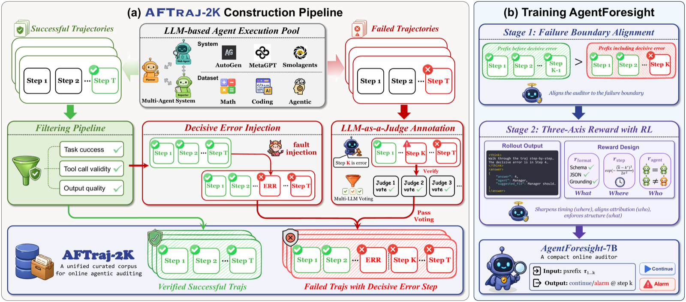
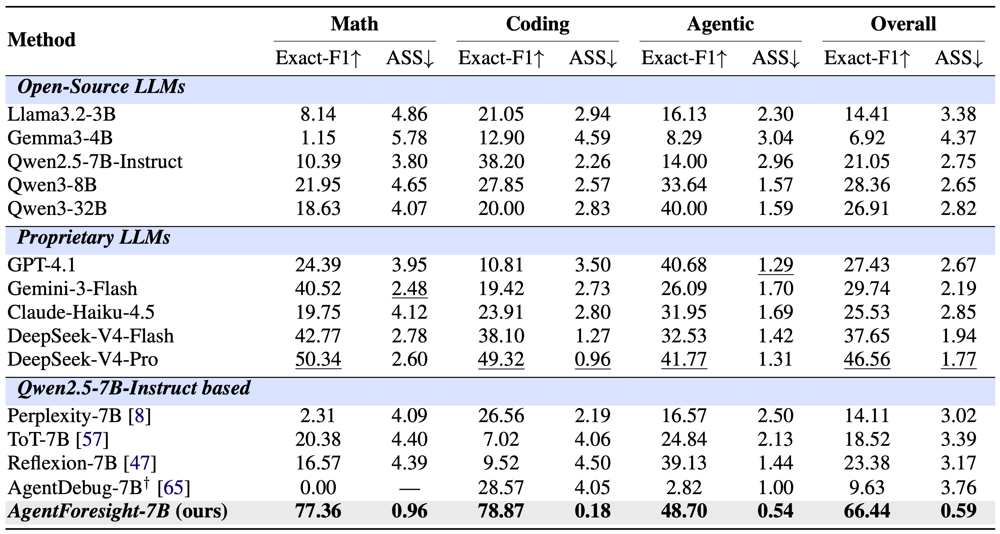

<div align="center">


## Online Auditing for Early Failure Prediction in Multi-Agent Systems

<p><a href="https://neurips.cc/Conferences/2026"></a></p>

<a href="https://arxiv.org/abs/2605.08715"></a>
<a href="https://zbox1005.github.io/agent-foresight/"></a>
<a href="https://huggingface.co/ZBox008003/AgentForesight-7B"></a>
<a href="https://huggingface.co/datasets/ZBox008003/AFTraj"></a>
<a href="LICENSE"></a>

</div>

## 🔥 Updates

- 🔥 **Nov 7, 2026:** Released the AgentForesight-7B model weights, BPPO and GRPO training code, public data preparation scripts, and trajectory collection scripts.
- 🔥 **Sep 24, 2026:** AgentForesight was accepted at NeurIPS 2026.
- 🔥 **May 9, 2026:** Released the AgentForesight repository with inference and evaluation code and the AFTraj-2K dataset.

## Overview

**AgentForesight** reframes multi-agent failure analysis from *post-hoc diagnosis* of completed trajectories to *online auditing* of unfolding ones. At each step of an unfolding trajectory, an auditor observes only the current prefix and must either continue the run or alarm at the earliest decisive error, opening a runtime intervention window before downstream propagation locks in failure.

We release **AFTraj-2K**, a curated corpus of 2,272 multi-agent trajectories (1,158 safe + 1,114 unsafe) across Coding, Math, and Agentic domains, and **AgentForesight-7B**, a compact online auditor trained with a coarse-to-fine reinforcement learning recipe.

<div align="center"></div>

## Key Highlights

- **Online auditing protocol** — We introduce *online auditing*, a deployment-time reframing of agentic failure analysis that audits unfolding trajectories step by step rather than diagnosing them after failure.
- **AFTraj-2K dataset** — We construct AFTraj-2K, a curated corpus of agentic trajectories spanning Coding, Math, and Agentic domains, pairing strictly filtered safe runs with multi-judge verified failure runs annotated at their *decisive error* step
- **A compact online auditor** — We develop *AgentForesight*-7B, a compact online auditor trained via a *coarse-to-fine* RL recipe that first equips it with a risk-anticipation prior at the failure boundary, then sharpens this prior into precise step-level localization under the structure, timing, and attribution optimization
- ***AgentForesight*-7B outperforms larger proprietary judges** — 66.44 overall Exact-F1 on AFTraj-2K, +19.9 points above DeepSeek-V4-Pro and a 3 $\times$ tighter Absolute Step Shift (ASS).

## AFTraj-2K Dataset

A unified corpus of multi-agent trajectories collected, filtered, and annotated for online auditing. 

Hosted on 🤗HuggingFace: [ZBox008003/AFTraj](https://huggingface.co/datasets/ZBox008003/AFTraj).

| Domain | Safe | Unsafe | Total |
|---|---:|---:|---:|
| Math      |   395 |   397 |   792 |
| Coding    |   361 |   247 |   608 |
| Agentic   |   402 |   470 |   872 |
| **TOTAL** | **1,158** | **1,114** | **2,272** |

## Installation

```bash
git clone https://github.com/ZBox1005/AgentForesight.git
cd AgentForesight
pip install -r requirements.txt
```

## Quickstart

### Load the dataset

```python
from huggingface_hub import snapshot_download
import pandas as pd

local_dir = snapshot_download(repo_id="ZBox008003/AFTraj", repo_type="dataset")
safe   = pd.read_parquet(f"{local_dir}/aftraj_safe.parquet")
unsafe = pd.read_parquet(f"{local_dir}/aftraj_unsafe.parquet")

print(safe.shape, unsafe.shape)
print(unsafe.iloc[0][["conv_id", "domain", "mistake_step", "mistake_agent"]])
```

### Run the auditor

Local model (transformers):
```bash
python -m inference.infer_local \
    --model-path  ZBox008003/AgentForesight-7B \
    --data-dir    <path_to_dataset> \
    --output-dir  ./outputs/auditor_local \
    --paper-test-split --macro-domain
```

OpenAI-compatible API (GPT-4.1, DeepSeek, vLLM-served local model, ...):
```bash
export OPENAI_API_KEY=sk-...
python -m inference.infer_api \
    --model       gpt-4.1 \
    --data-dir    <path_to_dataset> \
    --output-dir  ./outputs/gpt41 \
    --paper-test-split --macro-domain
```

Both commands use the paper auditor prompt, query each trajectory prefix in sequence, and stop at the first parseable alarm.

## Main Results

<div align="center"></div>

AgentForesight-7B reaches 66.44 overall Exact-F1, +19.88 points above the strongest proprietary baseline DeepSeek-V4-Pro, with a 3 $\times$ tighter ASS and the largest gains on Math (77.36 vs 50.34) and Coding (78.87 vs 49.32).

The model checkpoint and model card are public at [ZBox008003/AgentForesight-7B](https://huggingface.co/ZBox008003/AgentForesight-7B).

## Training recipe

The Stage 1 BPPO trainer, Stage 2 GRPO configuration, reward, prompt builder, and a script to prepare training inputs from the public AFTraj dataset are in [`training/`](training/). See [`training/README.md`](training/README.md) for the data preparation and training commands.

## Trajectory collection

The Math AutoGen Swarm and Agentic smolagents rollout scripts, including role prompts and tools, are in [`collection/`](collection/). See [`collection/README.md`](collection/README.md) for the task-data inputs and commands.

## Repository Structure

```
AgentForesight/
├── README.md
├── LICENSE
├── requirements.txt
├── inference/
│   ├── prompts.py        # prompt messages and response parser
│   ├── data.py           # parquet loader (with paper_test_split flag)
│   ├── metrics.py        # Exact-F1 / ASS / FAR / Step-Acc + macro-domain bucketing
│   ├── infer_local.py    # local-model auditor inference (transformers)
│   └── infer_api.py      # OpenAI-compatible API auditor inference
├── training/             # paper prompt, Stage 1 BPPO, and Stage 2 GRPO recipe
├── collection/           # Math AutoGen and Agentic smolagents rollouts
└── assets/
    ├── logo_full.png
    ├── pipeline.png
    └── main_table.png
```

## Citation

If you find this work useful, please cite:

```bibtex
@article{zhang2026agentforesight,
  title={AgentForesight: Online Auditing for Early Failure Prediction in Multi-Agent Systems},
  author={Zhang, Boxuan and Zhu, Jianing and Shi, Zeru and Liu, Dongfang and Tang, Ruixiang},
  journal={arXiv preprint arXiv:2605.08715},
  year={2026}
}
```

## License

- **Code** (`inference/`, `training/`, `collection/`): MIT License — see [LICENSE](LICENSE).
- **Dataset** (HuggingFace `ZBox008003/AFTraj`): CC BY 4.0.
